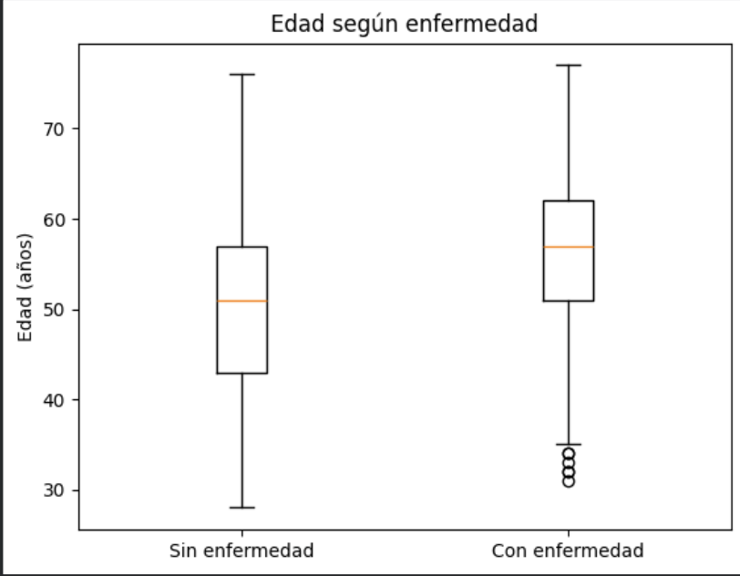
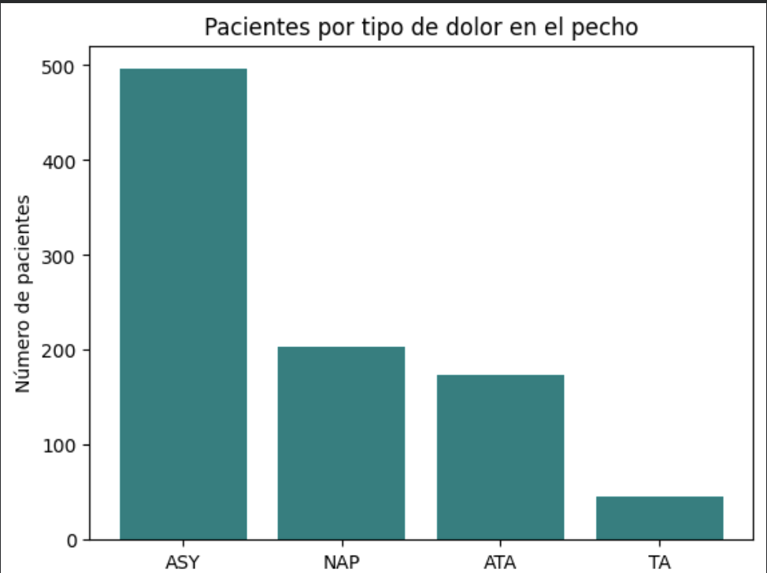
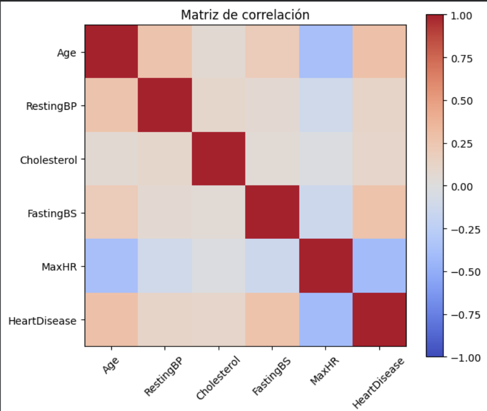
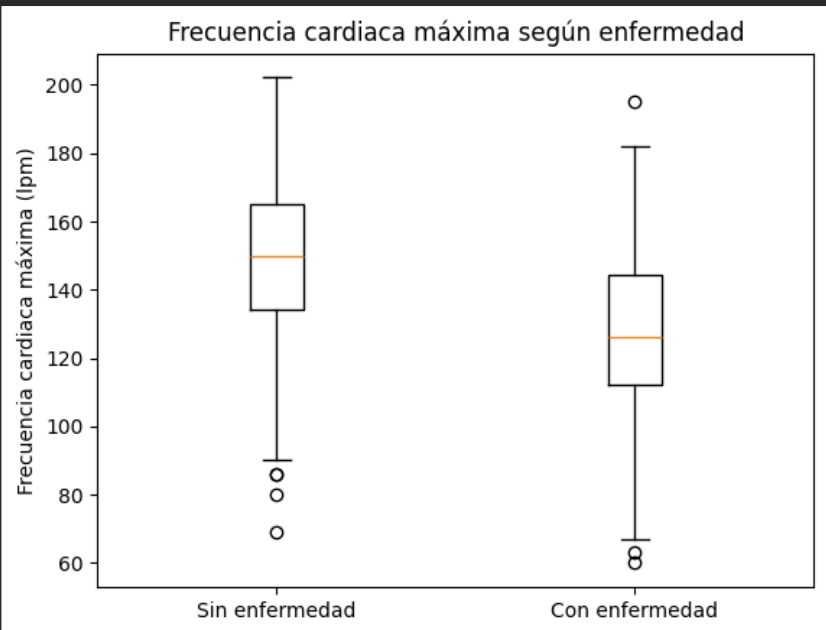
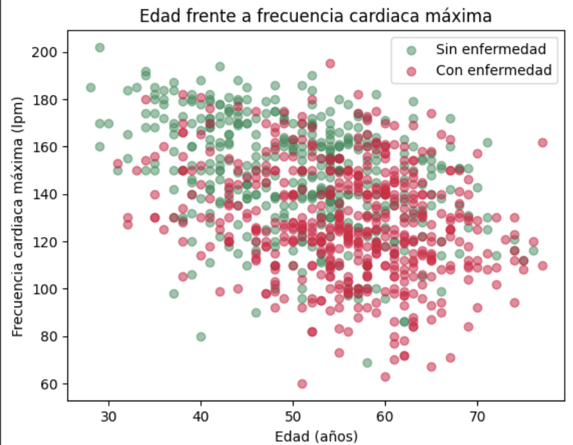

# ¿A quién derivamos primero a cardiología?

**Análisis exploratorio de datos (EDA) de 918 pacientes con sospecha de enfermedad cardiaca**

Proyecto realizado en el Curso de Especialización en Inteligencia Artificial y Big Data (CIFP César Manrique). Python · pandas · Matplotlib · Google Colab.

> ⚠️ Es un ejercicio de análisis de datos con fines formativos, **no una recomendación médica**.

---

## El problema

Un centro de salud tiene una lista de espera de cardiología muy larga y no puede derivar a todos los pacientes como urgentes. Necesita un **criterio sencillo, basado en datos que ya se miden en consulta**, para decidir quién va primero.

## Los datos

- **Dataset:** [Heart Failure Prediction](https://www.kaggle.com/datasets/fedesoriano/heart-failure-prediction) (fedesoriano, Kaggle).
- **Origen:** combina 5 conjuntos clínicos reales del [UCI Heart Disease](https://archive.ics.uci.edu/dataset/45/heart+disease): Cleveland, Hungría, Suiza, Long Beach VA y Statlog.
- **Tamaño:** 918 pacientes y 12 variables. El 55 % tiene enfermedad cardiaca.
- **Variables usadas:** edad, sexo, tipo de dolor en el pecho, tensión en reposo, colesterol y glucosa en ayunas (se miden en consulta); frecuencia cardiaca máxima y angina con ejercicio (salen de una prueba de esfuerzo).

## Preparación de los datos

| Revisión | Resultado | Decisión |
|---|---|---|
| Valores nulos | 0 | Nada que corregir |
| Duplicados | 0 | Nada que corregir |
| Ceros imposibles | 172 colesteroles y 1 tensión a 0 | **Pasarlos a nulo.** Rellenar con la media (244,6) los situaba por encima del umbral de colesterol alto (240) y subía artificialmente el % de enfermos con colesterol alto del 52,6 % al 64,1 % |
| Valores extremos | 15 pacientes | **Mantenerlos.** Son valores reales y 12 de los 15 tienen enfermedad: quitarlos eliminaría a los pacientes de más riesgo |
| Categorías | Bien escritas | Nada que corregir |

## Hipótesis y resultados

**1. Los hombres y los mayores de 55 años tienen más enfermedad cardiaca → ✅ Se cumple**

- Hombres: 63,2 % de enfermos. Mujeres: 25,9 %.
- Mayores de 55: 70,7 %. 55 o menos: 43,2 %.

**2. El dolor típico de angina es el más asociado a enfermedad cardiaca → ❌ No se cumple**

Los pacientes **asintomáticos** (sin el dolor típico) son los que más enfermedad tienen: **79 %**, frente al 43,5 % de la angina típica. Además, son el grupo más numeroso (496 de 918).

**3. El colesterol y la tensión altos indican más enfermedad → ≈ Solo en parte**

Hay algo más de enfermos con colesterol alto (52,6 % frente a 43,1 %) y con tensión alta (62,7 % frente a 51,2 %), pero su correlación con la enfermedad es muy débil (0,10 y 0,12). Pesan más la frecuencia cardiaca máxima (−0,40), la edad (0,28) y la glucosa en ayunas (0,27).

**Prueba de esfuerzo**

Los enfermos alcanzan una frecuencia cardiaca máxima más baja (mediana de 126 frente a 150 lpm), y el 85,2 % de quienes sienten angina con el ejercicio tienen enfermedad cardiaca.

 

## Recomendación

Derivar primero a los pacientes que cumplan **al menos uno** de estos tres criterios, que se pueden comprobar en una consulta normal:

1. Hombre mayor de 55 años
2. Dolor en el pecho sin el patrón típico (asintomático)
3. Glucosa alta en ayunas

| | % con enfermedad cardiaca |
|---|---|
| Cumplen algún criterio | **72,4 %** |
| No cumplen ninguno | **14,7 %** |

La regla detecta a **468 de los 508 enfermos (92 %)**. En cambio, el colesterol o la tensión, por sí solos, no deberían ser el criterio principal.

## Limitaciones

- **Pocas mujeres (21 %):** sus resultados son menos fiables.
- **No es población general:** todos los pacientes llegaron con sospecha de enfermedad cardiaca, por eso hay un 55 % de enfermos y la regla marca a 7 de cada 10. En la población general de un centro de salud serían muchos menos.
- **Colesterol incompleto:** falta en 172 pacientes (19 %), y el 88 % de ellos tiene enfermedad, así que esos datos no faltan al azar.
- **Datos antiguos y de fuera:** hospitales de EE. UU. y Europa, sin información de tabaco, peso ni antecedentes familiares.

## Cómo ejecutarlo

1. Abre el notebook en Colab con el botón de arriba.
2. Descarga `heart.csv` desde [Kaggle](https://www.kaggle.com/datasets/fedesoriano/heart-failure-prediction) y súbelo a Colab (icono de la carpeta, panel izquierdo).
3. *Entorno de ejecución → Ejecutar todo.*

## Autor

**Gabriel Hernández Álvarez** · [LinkedIn](https://www.linkedin.com/in/gabriel-hdez) · [GitHub](https://github.com/GabrielHdezAlv)
